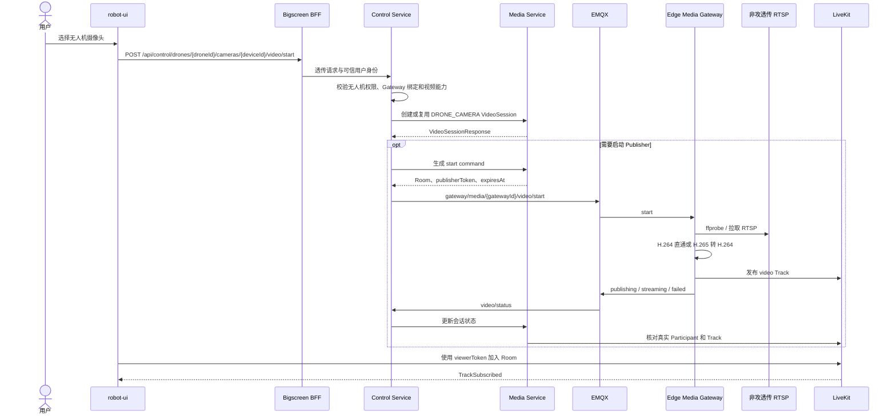

# 无人机视频与位置接入设计说明书

| 文档属性 | 内容 |
| --- | --- |
| 文档状态 | 实施中 |
| 方案日期 | 2026-10-10 |
| 实施状态 | 固定摄像头统一 Gateway 编排与授权目录已实现并通过本地验证；无人机平台接入、真实设备与生产部署尚未完成 |
| 适用范围 | `robot-ui`、`bigscreen-bff`、`control-service`、`media-service`、EMQX、LiveKit、规划中的 `media-gateway` |
| 外部设备 | 雷迅 LTE-LINK SE、非攻透传软件、无人机飞控与摄像头 |

本文定义无人机通过 LTE-LINK SE 和非攻透传软件接入平台的正式方案。方案复用平台现有
`VideoSession + LiveKit + 大屏播放组件` 主链路，将固定摄像头与无人机视频能力统一到 Edge Media Gateway，
飞行位置数据由独立的 Drone Telemetry Adapter 承接。非攻透传提供的 RTSP 作为首期视频输入，UDP 作为首期飞控数据输入；RTMP、GB28181、
TCP MPEG-TS 和原始 UDP 视频不进入首期生产链路。

字段、Topic 和接口在实施后应同步进入[实时视频接口与协议文档](../../03-接口与协议/实时视频/实时视频接口与协议文档.md)、
[客户端事件与载荷协议文档](../../03-接口与协议/客户端事件/客户端事件与载荷协议文档.md)及 OpenAPI 契约。

## 1. 背景与结论

LTE-LINK SE 是无人机侧蜂窝数传设备。非攻透传软件登录并绑定 LTE-LINK SE 后，在地面站侧把远端
无人机的飞控数据和视频转换为本机或局域网可消费的协议。现场资料和软件配置界面已经确认：

- 数据传输支持 UDP 和 TCP；文档示例使用 UDP `14550` 连接地面站软件。
- 视频传输支持 UDP、TCP、GB28181、RTSP 和 RTMP。
- RTSP 模式由非攻透传在地面站监听 IP、端口和路径，对外形成
  `rtsp://<地面站地址>:<端口>/<路径>`。
- RTMP 模式由非攻透传主动连接 RTMP 服务，分别配置服务地址和流名称或推流码。
- TCP 模式可以选择 `H265-MPEG-TS` 或 `H264-MPEG-TS`。
- RTSP 实际输出编码尚未现场确认，不能仅凭协议名称推定为 H.264。

本方案作出以下决定：

1. 首期视频使用非攻透传内置 RTSP 服务，Edge Media Gateway 按观看需求拉流并发布 LiveKit Track。
2. 首期位置与飞行状态使用 UDP `14550`；Drone Telemetry Adapter 确认并解析实际飞控协议，预期为 MAVLink，
   但必须以抓包和解析结果为准。
3. 视频源使用独立的 `DRONE_CAMERA` 语义，发布端使用 `EDGE_MEDIA_GATEWAY`；不得伪装成机器人摄像头或
   固定摄像头。
4. BFF、Control 和 Media 继续只处理认证、编排、状态和信令，不转发 RTSP、RTP 或 WebRTC 媒体包。
5. 浏览器继续直接订阅 LiveKit，不接触非攻透传地址、飞控 UDP 端口、发布 Token 或现场凭据。
6. 首期不以 RTMP 直推替代 RTSP 拉流。RTMP 适合常驻推流，但不符合首期按观看会话启停、按源探测
   和边缘转码的治理目标。
7. 固定摄像头与无人机视频使用同一 Edge Media Gateway 运行核心、统一 MQTT 协议和输入协议适配器，
   保留独立设备语义；飞控解析使用独立进程，Gateway 实例按站点和容量隔离部署。

### 1.1 当前交付边界

Go 源目录、module/import、部署服务与镜像名称已统一为 `media-gateway`，以 `internal/gateway` 和
`internal/app` 作为唯一运行核心，`cmd/media-gateway` 为唯一入口。该入口支持 `FIXED_CAMERA/DRONE_CAMERA` 受控源映射、
RTSP 协议适配、H.264/H.265 编码探测、转码选择、MQTT `start/stop/restart`、状态隔离和进程释放。

固定摄像头的 Control 命令、目录租约和健康消费已迁移至 `gateway/media/**`，Media 发布模式改为
`EDGE_MEDIA_GATEWAY`。BFF 的授权目录 HTTP 与对外播放接口保持原结构，MQTT 目录转换为通用 `sources[]`。
固定源必须有有效授权租约，不能回退本地固定源配置。旧命令入口和重复固定源目录实现已删除。
通用 `Input/StreamInfo/Adapter` 位于 `internal/media`，RTSP 实现位于 `internal/protocol/rtsp`；
源目录、运行核心和 Publisher 不再导入具体 RTSP 包。发布后端目前仍只实现 RTSP。
部署配置及数据库迁移脚本已提供，尚未应用到生产。配置与升级边界见[Gateway 模块说明](../../../media-gateway/README.md)。

`DRONE_CAMERA` 与无人机 HTTP 接口仍属于 Java 侧待实施契约；Go 保留受控本地无人机 RTSP 输入。
RTMP Ingress 的固定摄像头既有能力继续复用，统一 Gateway 的 RTMP、GB28181、RTP/UDP、MPEG-TS、SRT
输入适配以及 Drone Telemetry Adapter 尚未实现。真实视频转码、发布和浏览器播放仍需现场验收。

## 2. 目标与范围

### 2.1 目标

- 在大屏统一展示无人机位置、在线状态和实时视频。
- 复用现有 VideoSession、LiveKit Room/Token/Track、viewer、录像、抓拍和空闲释放能力。
- 支持按无人机、摄像头、通道和清晰度隔离视频源。
- 支持 MQTT `start`、`stop`、`restart` 的幂等控制和状态闭环。
- 支持 H.264 直通和 H.265 到 H.264 的低延迟转换。
- 支持 RTSP、发布进程、LiveKit Track、飞控 UDP 和 Gateway 自身的分层健康状态。
- 支持 MQTT、RTSP 或发布进程异常后的受控恢复，并保证停止命令不会被迟到的恢复命令覆盖。

### 2.2 首期范围

- 单路可见光视频，`channel=visible`。
- `quality=main/sub` 的业务语义；是否存在真实双码流由现场设备能力决定。
- 非攻透传 RTSP 输入。
- 飞控位置、海拔、航向、速度、电量、飞行模式和定位状态上报。
- 大屏视频播放、位置更新、抓拍和 LiveKit Egress 录像复用。
- Edge Media Gateway 心跳、视频源健康、飞控数据健康、会话状态和运行指标。

### 2.3 非目标

- 不通过 BFF、Control 或 Media 中转媒体包。
- 不在浏览器中直接播放 RTSP、RTMP、MPEG-TS 或原始 UDP 视频。
- 不在首期接入 GB28181、TCP MPEG-TS、原始 UDP/RTP 视频和 RTMP Ingress。
- 不在本方案中定义飞行控制、航线下发、云台控制和载荷控制协议。
- 不把第三方地面站播放器作为平台生产组件。
- 不建立独立于现有 VideoSession 和 LiveKit 的第二套播放、录像或抓拍链路。

## 3. 总体架构

### 3.1 视频、控制与状态链路

```text
无人机摄像头
  -> LTE-LINK SE
  -> 蜂窝网络与厂商链路
  -> 非攻透传内置 RTSP 服务
  -> Edge Media Gateway（探测、拉流、转码、Publisher 生命周期）
  -> LiveKit Track
  -> robot-ui

robot-ui
  -> Bigscreen BFF（JWT 与可信身份）
  -> Control Service（权限、源路由、MQTT 编排）
  -> Media Service（VideoSession、Room、Token、Track、viewer、录像）
  -> Control Service
  -> EMQX
  -> Edge Media Gateway（start / stop / restart）

Edge Media Gateway
  -> EMQX（Gateway 心跳、源健康、视频会话状态）
  -> Control Service
  -> Media Service（会话状态与 LiveKit Track 事实对账）
```

### 3.2 位置与飞行状态链路

```text
无人机飞控
  -> LTE-LINK SE
  -> 蜂窝网络与厂商链路
  -> 非攻透传 UDP 14550
  -> Drone Telemetry Adapter（协议解析、校验、归一化、限频）
  -> MQTT eiop/v1/edge/{serialNumber}/status
  -> Control Service
  -> Bigscreen BFF WebSocket
  -> robot-ui 地图和装备状态
```

视频和位置共享无人机 `serialNumber/sourceId`，但生命周期独立：位置正常不代表视频可播放，RTSP
可用也不代表飞控数据新鲜。大屏分别显示装备在线、定位质量、视频源健康和当前视频会话状态。

### 3.3 正常启动时序



## 4. 组件职责

| 组件 | 职责 | 禁止事项 |
| --- | --- | --- |
| Management Service | 无人机档案、序列号、组织权限、摄像头能力、Gateway 绑定 | 不保存发布 Token，不承载媒体流 |
| Bigscreen BFF | JWT 验证、可信身份注入、展示聚合、WebSocket 桥接 | 不返回 RTSP 地址，不代理媒体包，不复制会话逻辑 |
| Control Service | 权限校验、无人机源路由、调用 Media、MQTT 命令和状态桥接 | 不创建媒体文件，不拉取或转码 RTSP |
| Media Service | VideoSession、Room、Token、Track、viewer、录像、空闲释放和 LiveKit 事实对账 | 不读取现场 RTSP，不直接发 MQTT |
| Edge Media Gateway | 多设备视频接入、编码识别与转换、LiveKit 发布、MQTT、恢复和资源清理 | 不签发浏览器 Token，不决定用户权限，不解析飞控数据 |
| Drone Telemetry Adapter | 飞控 UDP 接入、协议解析、位置与飞行状态归一化 | 不承载视频发布，不管理 VideoSession |
| LiveKit | Room、Participant、Track、WebRTC 和 Egress | 不保存无人机档案，不解释飞控数据 |
| robot-ui | 发起观看、订阅 Track、展示位置和状态、前端抓拍 | 不访问 RTSP、UDP 或发布 Token |

### 4.1 Edge Media Gateway 边界

`media-gateway` 使用 Go 实现，继承固定摄像头 Gateway 的 MQTT、Publisher 进程管理、敏感日志脱敏、
进程组清理、健康检查和指标。媒体输入按协议分派，固定摄像头和无人机保留独立 `sourceType`。

Edge Media Gateway 负责：

- 维护 `sourceType + sourceId + deviceId` 到本地视频输入地址、协议和能力的受控映射。
- 订阅本 Gateway 的视频 `start/stop/restart` Topic。
- 在启动前探测 RTSP 并识别编码、分辨率、帧率和码率。
- 为 H.264 选择无损重封装或直通，为 H.265 启动低延迟 H.264 转码。
- 使用 Media 签发的短期 publisher Token 发布指定 LiveKit Room。
- 以 stream key 复用同源 Publisher，以 `sessionId` 精确绑定和释放观看会话。
- 上报 Gateway、视频源和会话状态；提供只读 `/health` 和 `/metrics`。
- MQTT 断开、进程异常或服务退出时停止受影响 Publisher，避免无人值守推流残留。

Edge Media Gateway 不负责：

- 用户身份、组织权限和无人机授权判断。
- 生成 VideoSession、Room 或 Token。
- 将 RTSP 地址、LiveKit Token 或原始飞控报文暴露给浏览器。
- 将 Gateway 进程状态当作 LiveKit Track 已存在的最终事实。
- 解析 MAVLink、维护飞行模式或位置状态；这些能力由 Drone Telemetry Adapter 承担。

### 4.2 与固定摄像头 Gateway 的关系

目标是将固定摄像头 Gateway 演进为统一媒体服务，固定摄像头和无人机视频共用 Publisher、MQTT、探测、
健康检查、恢复和资源清理。`sourceType` 保留 `FIXED_CAMERA/DRONE_CAMERA`，`publisherMode` 表示
`EDGE_MEDIA_GATEWAY/LIVEKIT_INGRESS` 等发布路径，`sourceProtocol` 表示输入协议；三者分别定义。

统一服务可以在一个实例中处理两类视频源，但每路 Publisher 使用独立子进程和源锁。实例按站点、协议
或容量部署，MQTT Client ID 和监听端口必须唯一，ACL 只允许当前 `gatewayId` 的主题。视频源健康按
`sourceType + sourceId + deviceId` 隔离，不能用一个源的状态覆盖另一设备。

飞控 UDP、MAVLink、位置和飞行模式由 Drone Telemetry Adapter 独立处理。其协议解析故障不会直接
终止通用媒体服务。RTMP 直推 LiveKit Ingress 的媒体包继续绕过媒体 Gateway。

当前代码只保留统一命令入口，固定摄像头使用平台授权租约，无人机本地输入配置仅用于已实现的 Go 能力。
生产切换前必须停止旧服务，执行发布模式数据库迁移，协同更新管理端目标模式调用与 MQTT ACL，并部署
同一协议版本的 Control、Media 和 Gateway。旧镜像会被打包协议标签校验拒绝，不能与新服务混用。

### 4.3 公共代码与模块组织

单服务内按业务源隔离，不复制固定摄像头和无人机的运行核心；已统一的基础能力包括：

- MQTT 连接、QoS 1、重连、遗嘱和 ACL 配置。
- `start/stop/restart` 命令骨架、`commandId` 去重和 `sessionId` 终止水位。
- Publisher 进程组管理、超时、强制清理和退出监视。
- LiveKit 发布、Token 有效期检查和 Track 命名辅助能力。
- RTSP 探测、恢复退避、敏感日志脱敏、健康检查和指标。

媒体服务按协议注册适配器，按业务源注册配置。飞控解析、位置映射和飞行状态保持独立。当前代码结构为：

```text
media-gateway/                  # 统一 Go module 与部署服务
  cmd/media-gateway/            # 统一视频入口
  internal/app/                # 统一启动与观测逻辑
  internal/gateway/            # 命令、状态、去重和终止水位
  internal/media/              # 通用 Input、StreamInfo、Adapter 和安全错误
  internal/source/             # 业务源注册表和授权租约
  internal/protocol/rtsp/      # RTSP 校验和探测；首批唯一具体协议
  internal/publisher/          # LiveKit 发布、转码选择、进程管理
drone-telemetry-adapter/        # 独立飞控适配进程，待实现
```

统一运行核心依赖协议接口，不按设备类型复制 RTSP 发布代码。适配器只负责媒体输入校验和探测，Publisher
管理发布进程；未来 RTMP、GB28181、RTP/UDP、MPEG-TS、SRT 的监听、会话协商和释放必须在各自协议层
实现，且须适配对应发布后端，不能仅添加枚举就宣称已支持。旧实例停止、发布模式数据库迁移、
镜像构建与现场验收仍属于上线批次；目录和部署引用更名本身不代表生产已切换。

## 5. 视频源与会话模型

### 5.1 视频源类型

共享契约新增：

```text
VideoSourceType.DRONE_CAMERA
VideoPublisherMode.EDGE_MEDIA_GATEWAY
```

必要字段：

| 字段 | 示例 | 语义 |
| --- | --- | --- |
| `sourceType` | `DRONE_CAMERA` | 无人机摄像头的权威类型 |
| `sourceId` | `drone-001` | 无人机序列号或平台权威设备 ID |
| `deviceId` | `camera01` | 无人机上的具体摄像头 |
| `channel` | `visible` | 首期只支持可见光 |
| `quality` | `main` | 逻辑清晰度；必须与实际源能力匹配 |

`taskId` 不属于 VideoSession 必填字段。任务与视频的关联由上层业务上下文维护，不改变媒体会话的
源标识和复用键。

Media 内部创建请求应以 `sourceType + sourceId + deviceId` 为权威标识。实施时不得为了满足当前
`robotId` 非空约束而把无人机 ID 填入机器人字段；应调整共享请求模型和校验，使非机器人视频源不依赖
伪造的机器人身份。

### 5.2 Room、Participant 与 Track

Room 名称：

```text
media.drone.{sourceId}.{deviceId}.{channel}.{quality}
```

Publisher identity：

```text
drone:{sourceId}:{deviceId}:{channel}:{quality}
```

Track name：

```text
video.{channel}.{quality}
```

命名中的每个动态段必须经过现有 Room 命名规则校验和归一化，不能直接拼接用户输入。

### 5.3 会话复用与释放

复用键保持平台统一规则：

```text
sourceType + sourceId + deviceId + channel + quality
```

- 同一复用键只有一个运行中的 Publisher，可以绑定多个 VideoSession/viewer。
- 新 viewer 复用已有真实 Track 时，不重复下发 start。
- 停止一个 viewer 只解除该 viewer 与会话占用，不影响其他 viewer 或活动录像。
- 最后一个 viewer 和活动录像都释放后进入 `IDLE_WAIT`，延时到期才下发 stop。
- `stop` 按 `sessionId` 精确解除绑定；只在 stream key 无任何会话占用时停止进程。
- LiveKit Room API 中的预期 Participant/Track 是 `STREAMING` 和复用的最终事实。

### 5.4 对外启动接口

建议新增：

```http
POST /api/control/drones/{droneId}/cameras/{deviceId}/video/start
Content-Type: application/json

{
  "channel": "visible",
  "quality": "main",
  "reuse": true,
  "clientRequestId": "optional"
}
```

后续 Token、viewer 心跳、停止、重启、录像和抓拍继续复用 `/api/control/video-sessions/**`。新增接口必须
按 OpenAPI 流程定义请求、响应、身份、错误结构和兼容性，不在 Markdown 中复制全部 HTTP Schema。

## 6. 非攻透传与本地源配置

### 6.1 推荐部署

首选把非攻透传和 Edge Media Gateway 部署在同一台受控现场主机：

```text
非攻透传 RTSP 监听：127.0.0.1:<rtsp-port>/<path>
非攻透传数据目标：127.0.0.1:<telemetry-port>
Edge Media Gateway：读取本地 RTSP
Drone Telemetry Adapter：监听本地飞控 UDP
```

该部署不向局域网暴露 RTSP 和飞控 UDP。如果二者必须分机部署：

- 非攻透传 RTSP 可以监听 `0.0.0.0` 或指定现场网卡地址。
- Edge Media Gateway 必须使用地面站实际 IP，不能连接 `0.0.0.0`。
- 防火墙只允许 Edge Media Gateway 主机访问 RTSP 和飞控 UDP 端口。
- 禁止直接把 RTSP、UDP 或 Edge Media Gateway 健康端口暴露到公网。

### 6.2 源映射

RTSP 地址和飞控 UDP 端口分别由媒体 Gateway 和飞控适配器管理，不进入前端或普通业务响应。
当前媒体源使用 JSON 文件；示例地址仅供说明，部署时必须替换：

```json
{
  "sources": [
    {
      "sourceType": "DRONE_CAMERA",
      "sourceId": "drone-001",
      "deviceId": "camera01",
      "sourceProtocol": "RTSP",
      "mainStreamUrl": "rtsp://ground-station.example:8554/drone-001"
    }
  ]
}
```

真实 RTSP 凭据、MQTT 密码和 LiveKit Token 不得写入仓库。多个无人机在同一主机运行时，应为每个
`sourceId` 配置唯一 RTSP path；飞控数据可以按已验证的 MAVLink system ID 复用端口，否则使用独立
UDP 端口，避免来源归属不确定。

### 6.3 编码探测与发布策略

Gateway 每次启动新源前使用 `ffprobe` 或等效能力读取：

- `codec_name`
- 分辨率和帧率
- 是否持续产生关键帧
- RTSP 建连和首包耗时

处理规则：

| 输入 | 处理 |
| --- | --- |
| H.264 且 Profile/Level、像素格式和时间戳满足 LiveKit 发布要求 | 优先直通或仅重封装 |
| H.265 | 解码并转换为低延迟 H.264 |
| 无视频 Track | 上报 `SOURCE_VIDEO_EMPTY`，不启动 Publisher |
| 不支持的编码或参数 | 上报 `SOURCE_CODEC_UNSUPPORTED` |

H.265 到 H.264 转码使用 `yuv420p`、零延迟参数、受控 GOP 和码率；具体 Profile、Level、分辨率、帧率
和码率必须根据真实设备样本与浏览器兼容性测试确定，本文不把未验证参数写成生产默认值。转码过载时应
快速失败并上报，不以无限排队换取表面可用。

## 7. MQTT 协议设计

### 7.1 Topic

| 场景 | Topic | QoS | retained |
| --- | --- | ---: | ---: |
| 启动视频 | `gateway/media/{gatewayId}/video/start` | 1 | 否 |
| 停止视频 | `gateway/media/{gatewayId}/video/stop` | 1 | 否 |
| 重启视频 | `gateway/media/{gatewayId}/video/restart` | 1 | 否 |
| 视频会话状态 | `gateway/media/{gatewayId}/video/status` | 1 | 否 |
| Gateway 心跳 | `gateway/media/{gatewayId}/status` | 1 | 否，离线使用遗嘱 |
| 媒体源健康 | `gateway/media/{gatewayId}/source/{sourceType}/{sourceId}/{deviceId}/status` | 1 | 否 |
| 飞控与位置状态 | `eiop/v1/edge/{serialNumber}/status` | 1 | 否 |

业务启停只通过 MQTT；HTTP 只保留只读 `/health` 和 `/metrics`。

### 7.2 视频命令最小载荷

```json
{
  "commandId": "cmd_xxx",
  "sessionId": "vs_xxx",
  "sourceType": "DRONE_CAMERA",
  "sourceProtocol": "RTSP",
  "sourceId": "drone-001",
  "deviceId": "camera01",
  "channel": "visible",
  "quality": "main",
  "roomName": "media.drone.drone-001.camera01.visible.main",
  "livekitUrl": "wss://<livekit-host>",
  "publisherToken": "<short-lived-token>",
  "expiresAt": "2026-10-10T12:00:00Z"
}
```

约束：

- `start` 是幂等的确保发布操作；重复的 `commandId` 返回当前结果，不启动第二个进程。
- `restart` 明确替换同一 stream key 的旧 Publisher，并保留仍有效的会话绑定。
- `stop` 以 `sessionId` 为精确释放单元，并记录终止水位；迟到的 start/restart 不得复活已停止会话。
- `expiresAt` 只限制 publisher Token 建立新连接的截止时间，不主动终止已建立的健康发布。
- RTSP 地址不随普通命令下发，由 Gateway 根据 `sourceType + sourceId + deviceId` 从本地受控配置解析。
- 日志只记录命令 ID、会话 ID、源 ID、状态和枚举原因码，不记录 Token、完整 URL 或凭据。

### 7.3 会话状态

Gateway 上报以下状态：

| 状态 | 语义 |
| --- | --- |
| `publishing` | RTSP 探测成功，发布进程开始启动 |
| `streaming` | 发布进程运行；Media 仍须通过 LiveKit 核对真实 Track |
| `interrupted` | 已发布会话因 RTSP、网络、进程或 MQTT 异常中断 |
| `failed` | 启动或恢复失败，携带枚举原因码 |
| `stopped` | 指定会话绑定已经释放 |

设备状态不能直接把 VideoSession 认定为 `STREAMING`。Media 以 LiveKit Room API 中预期 Participant
和视频 Track 为最终事实；Webhook 只触发核对。

## 8. 飞控与位置数据

### 8.1 协议确认

文档中 UDP `14550` 和第三方地面站的使用方式表明数据很可能为 MAVLink，但正式实施前必须完成：

1. 捕获真实 UDP 报文并确认 MAVLink 版本、消息类型和 system/component ID。
2. 验证经纬度、高度、航向、速度、电量和飞行模式的来源与单位。
3. 确认一台非攻透传实例连接多台无人机时的来源区分规则。
4. 确认断线、重连和设备重启后的序列号、时间戳和 system ID 稳定性。

未完成以上确认前，不能把 MAVLink 当作已验证的生产协议。

### 8.2 数据映射

确认协议后，Drone Telemetry Adapter 将数据归一到现有边缘状态 Topic：

```json
{
  "messageId": "msg_xxx",
  "messageType": "DEVICE_STATUS_REPORT",
  "schemaVersion": "1.0",
  "timestamp": "2026-10-10T20:00:00+08:00",
  "payload": {
    "status": {
      "basic": {
        "runningStatus": "FLYING",
        "healthStatus": "NORMAL"
      },
      "motion": {
        "moving": true,
        "speed": 12.4
      },
      "energy": {
        "batteryPercent": 76
      },
      "localization": {
        "localized": true,
        "coordinateType": "WGS84",
        "longitude": 116.397,
        "latitude": 39.908,
        "coordinateZ": 86.5,
        "yaw": 135.0
      },
      "rawStatus": {
        "protocol": "MAVLINK",
        "systemId": 1
      }
    }
  }
}
```

示例值只说明字段结构，不是现场数据。映射要求：

- 将协议原始整数单位转换为平台标准数值后再发布，不把缩放后的整数冒充经纬度或米。
- `coordinateType` 必须使用现场确认的坐标系；未经转换的 WGS84 数据不能标记为 GCJ-02。
- 原始设备时间必须带时区或使用协议定义的 UTC 时间；无法验证时单独记录接收时间，不伪造设备时间。
- 非法经纬度、NaN、无限值、未来时间和明显乱序消息不得覆盖最后有效位置。
- 输入可以高频，平台状态按配置限频并保留最新有效值；首期建议对外不高于每秒 1 次，与现有大屏位置事件节流一致。
- 连续超过现有边缘状态超时阈值未收到有效状态时，由 Control 转为离线；视频 Track 可独立保持或中断。

### 8.3 状态分层

| 状态 | 判断依据 | 用途 |
| --- | --- | --- |
| Gateway 健康 | MQTT 心跳与遗嘱 | 判断边缘服务是否在线 |
| 飞控链路健康 | 最近一条合法报文时间、解析错误率 | 判断位置和飞行状态是否可信 |
| RTSP 源健康 | RTSP 探测和最近视频包 | 判断视频源是否可读取 |
| Publisher 健康 | 本地发布进程状态 | 判断是否正在尝试发布 |
| LiveKit Track 健康 | Room API 中的 Participant/Track | 判断浏览器是否有可订阅媒体 |

任何一层不得代替另一层。特别是飞控位置持续更新不能证明视频正常，本地 Publisher 运行也不能证明
LiveKit 中存在真实 Track。

## 9. 异常、恢复与资源治理

### 9.1 异常分类

以下为跨服务目标分类；当前统一入口已实现的 `SOURCE_*`、`MEDIA_*` 和发布原因码以
[Gateway 模块说明](../../../media-gateway/README.md#统一媒体入口)为准。飞控超时、转码容量门禁和
LiveKit 连接细分诊断属于后续闭环，不能依据表中名称推定已经实现。

| 原因码 | 场景 | 处理 |
| --- | --- | --- |
| `DRONE_SOURCE_NOT_CONFIGURED` | Gateway 找不到源映射 | 失败，不重试配置错误 |
| `DRONE_RTSP_UNREACHABLE` | RTSP 建连或首包超时 | 上报失败，按有界退避重试 |
| `DRONE_VIDEO_SOURCE_EMPTY` | RTSP 中无视频 Track | 上报失败，等待源健康恢复 |
| `DRONE_VIDEO_CODEC_UNSUPPORTED` | 编码或参数无法处理 | 上报失败，停止进程 |
| `DRONE_TRANSCODE_OVERLOADED` | 转码资源不足 | 快速失败并告警，不无限排队 |
| `DRONE_PUBLISH_PROCESS_EXITED` | 发布进程异常退出 | 清理进程组，受控恢复 |
| `DRONE_LIVEKIT_CONNECT_FAILED` | Token、网络或 LiveKit 连接失败 | Token 有效期内退避重试，过期后请求新命令 |
| `DRONE_TELEMETRY_TIMEOUT` | 飞控数据超时 | 标记定位过期，不伪造新位置 |
| `DRONE_TELEMETRY_PARSE_FAILED` | 飞控报文无法解析 | 计数并保留最后有效位置；持续异常时告警 |
| `DRONE_MQTT_CONNECTION_LOST` | MQTT 断开 | 停止受控 Publisher，上报能力恢复后再编排 |

### 9.2 恢复原则

- 恢复前由 Control/Media 核对会话仍有 viewer 或活动录像占用。
- Gateway 恢复在线时先核对 LiveKit Track，健康 Publisher 不强制重启。
- RTSP 从不可用恢复时，只恢复对应 `sourceId + deviceId` 的中断会话。
- 同一 stream key 同时只允许一个恢复操作；并发命令通过源级锁串行化。
- 使用有上限的指数退避和随机抖动，避免厂商链路恢复时所有源同时重连。
- 进程退出、超时、stop、MQTT 断线和服务关闭都必须回收整个进程组、管道和文件句柄。
- 显式 stop 的终止水位优先于迟到的自动恢复命令。

## 10. 安全与部署

### 10.1 网络边界

- 生产 REST/WebSocket 统一从 BFF 进入；Control、Media、EMQX 和 LiveKit 管理接口位于受信网络。
- 非攻透传与 Edge Media Gateway 同机时，RTSP 和 UDP 只绑定回环地址。
- 分机部署时用主机防火墙限制源地址；RTSP 和飞控 UDP 不做公网端口映射。
- LiveKit WebRTC 端口按现有部署开放，不能用 Nginx 信令代理替代 ICE 媒体端口。
- MQTT 生产环境使用 TLS、独立 Gateway 凭据和 Topic ACL；单个 Gateway 不能订阅其他 Gateway 的命令。

### 10.2 凭据与日志

- RTSP 凭据、MQTT 密码、LiveKit API Secret、publisher Token 和 viewer Token 使用密钥或环境配置管理。
- publisher Token 只允许发布指定 Room，viewer Token 只允许订阅授权 Room。
- 不记录完整 RTSP URL、Token、飞控原始报文、账号、密码或个人信息。
- 第三方进程输出进入日志前必须按 Token、URL 和凭据进行脱敏，同时保留原始错误类型和退出码。

### 10.3 可观测性

Edge Media Gateway 至少提供：

- 活动 Publisher 数、活动会话绑定数和转码进程数。
- RTSP 探测成功率、建连耗时、首包耗时和连续失败数。
- 发布进程异常退出、强制清理次数和清理耗时。
- H.264 直通与 H.265 转码数量、转码 CPU/GPU 使用和丢帧数。
- Drone Telemetry Adapter 单独提供飞控报文时间、解析成功率、乱序数和无效位置数。
- MQTT 重连次数、状态队列积压和 LiveKit 发布失败数。

`/health` 和 `/metrics` 仅供内部探测，不提供业务启停接口，不返回 RTSP URL 或凭据。

## 11. 方案取舍

| 方案 | 结论 | 原因 |
| --- | --- | --- |
| RTSP -> Edge Media Gateway -> LiveKit | 首期采用 | 支持按观看启停、探测、转码、恢复和资源治理，最大化复用现有 VideoSession/LiveKit 链路 |
| RTMP -> LiveKit Ingress | 后续评估 | 链路短，但通常为常驻推流；需验证 H.264、完整 URL/stream key、断流恢复和无人机 Ingress 生命周期 |
| TCP MPEG-TS | 不进入首期 | 非攻透传可选 H.264/H.265，但平台仍需专用接收器，未带来比 RTSP 更清晰的治理收益 |
| UDP/RTP 视频 | 不进入首期 | 需要 SDP、端口管理、抖动缓冲和自定义接收，现场维护成本更高 |
| GB28181 | 不进入首期 | 当前平台没有 SIP/国标平台注册、目录和级联能力 |

### 11.1 首期暂不采用 RTMP 的原因

非攻透传已经具备 RTMP 服务地址和推流路径配置，因此 RTMP 在技术上是候选方案，不是被永久排除。
首期仍选择 RTSP，原因是当前尚未形成以下生产闭环：

1. **观看生命周期不可控**：RTMP 由非攻透传主动推送，尚未确认平台能否通过受控接口按 viewer 占用
   精确启动、停止和重启某一路推流。不能控制时，会长期占用地面端出口带宽和 LiveKit Ingress 资源。
   LTE-LINK 到非攻透传的蜂窝上行是否随观看启停，需另行验证；RTSP 按需拉取本身不证明节省蜂窝流量。
2. **编码能力未确认**：支持 RTMP 不代表输出一定是标准 H.264 RTMP/FLV。若实际为 H.265 或增强
   RTMP，LiveKit Ingress 可能无法直接接收，仍需增加转码层。
3. **现有 Ingress 语义不适用**：当前 RTMP Ingress 编排面向固定摄像头，不能用
   `FIXED_CAMERA + LIVEKIT_INGRESS` 承载无人机。正式接入必须补齐 `DRONE_CAMERA` 的 Ingress 身份、
   权限和生命周期。
4. **视频与飞控健康分裂**：RTMP 绕过 Edge Media Gateway 后，视频由 LiveKit Ingress 负责，位置由 Drone
   Telemetry Adapter 负责。平台需要额外关联 RTMP Track、无人机身份、飞控在线和非攻透传实例，排障与恢复边界
   更复杂。
5. **Ingress 治理未闭环**：仍需确定 RTMP URL、stream key 生成和轮换、断流恢复、重复 Publisher、
   常驻 Track 复用、协议切换 generation 以及旧发布端清理。

RTSP 首期方案允许 Edge Media Gateway 在启动前探测编码，按需拉流，必要时完成 H.265 到 H.264 转换，并将
MQTT 启停、源健康、Publisher 进程和 LiveKit Track 事实放在同一个可观测闭环内。选择 RTSP 是当前证据
条件下的生产基线，不表示其链路长度优于已验证可控的 RTMP。

### 11.2 RTMP 升级门禁

以下条件全部通过真实设备验证后，可以重新评审并将视频链路调整为 RTMP 直推优先：

1. 非攻透传输出标准、稳定且与 LiveKit Ingress 兼容的 H.264 RTMP。
2. 每架无人机可以获得唯一、稳定、可轮换的 RTMP 地址和 stream key。
3. 平台可以接受常驻推流的蜂窝流量和 Ingress 占用，或非攻透传提供可自动化调用的精确启停能力。
4. 弱网、断网、非攻透传重启和无人机切换后，原身份能够恢复且不会产生重复 Publisher。
5. Media 和 Control 完成 `DRONE_CAMERA + LIVEKIT_INGRESS` 建模、权限、Track 核对和 generation 门禁。
6. 旧 RTMP 发布端、旧 Ingress 和旧 stream key 可以在协议切换后确定性清理。

通过门禁后的链路为：

```text
无人机摄像头
  -> LTE-LINK SE
  -> 非攻透传 RTMP
  -> LiveKit Ingress
  -> LiveKit Track
  -> robot-ui
```

此时 Edge Media Gateway 不承担该直推视频源的拉流、转码和 LiveKit Publisher。Drone Telemetry Adapter
继续负责飞控 UDP、位置与飞行状态、适配器心跳、无人机身份关联，并协助 Control 区分“飞控在线但
RTMP Track 不存在”和“RTMP Track 正常但飞控数据超时”。RTMP 方案不得直接复用固定摄像头档案或 Topic。

## 12. 实施范围

### 12.1 共享契约与 Media

- `media-common` 新增 `DRONE_CAMERA` 和 `EDGE_MEDIA_GATEWAY`。
- Media 的会话创建约束从机器人兼容字段收敛到 `sourceType/sourceId/deviceId`。
- 增加无人机 Room 和 Publisher identity 规则。
- 将无人机会话纳入 Track 事实对账、viewer、录像、空闲释放和恢复候选逻辑。

### 12.2 Control

- 新增无人机视频启动入口和权限校验。
- 从 Management 获取无人机档案、摄像头能力和 Gateway 绑定，不读取现场 RTSP 凭据。
- 按 `sourceType + gatewayId` 路由到统一媒体 MQTT Topic，保持业务源标识不变。
- 消费 Edge Media Gateway 心跳、源健康和视频会话状态。
- 继续消费 `eiop/v1/edge/{serialNumber}/status`，核对无人机定位字段与现有设备状态模型的语义。

### 12.3 Edge Media Gateway

- 新增独立生产模块、镜像、配置、健康检查和指标。
- 从两类 Gateway 中抽取稳定且领域无关的公共基础包，不复制 Publisher、MQTT、进程清理和脱敏实现。
- 各 Gateway 实例使用独立 MQTT Client ID、Topic ACL 和监听端口；固定摄像头和无人机按源隔离进程。
- 实现 RTSP 探测、编码选择、转码/直通、LiveKit 发布和进程治理。
- 实现 MQTT 命令、状态、去重、终止水位和恢复。
- 飞控 UDP 接收、协议解析、状态归一化和限频由独立 Drone Telemetry Adapter 实现。

### 12.4 BFF 与前端

- BFF 增加无人机展示和视频启动白名单代理，保留统一认证边界。
- 大屏设备模型识别 `DRONE_CAMERA`，复用 LiveKit 播放、抓拍、录像和消费者生命周期。
- 地图按现有位置事件更新无人机图标，并分别展示定位、视频源和会话状态。
- 无人机不得出现机器人专用控制入口，除非另有已批准的飞控设计。

### 12.5 文档与契约

- 更新实时视频接口与协议、客户端事件与载荷、Java 服务接口总览和相关模块 README。
- 新增 HTTP 接口时生成并审查 Media、Control 和 BFF OpenAPI 契约。
- 新增 MQTT 字段时同步生产者、消费者、DTO、状态机、错误码和测试方案。

## 13. 验证与验收

### 13.1 现场前置验证

- 非攻透传 RTSP URL 在同机和目标部署拓扑下可稳定拉取。
- `ffprobe` 记录真实编码、Profile、Level、分辨率、帧率、码率、音频和关键帧间隔。
- 确认一台非攻透传实例的多无人机 RTSP path 与飞控数据来源区分方式。
- 抓包确认飞控协议、版本、消息类型、单位、时间戳和坐标系。
- 记录蜂窝网络切换、弱网、设备重启和软件重登录后的地址与身份稳定性。

### 13.2 功能验收

- 有权限用户能启动、复用、停止和重启无人机视频，无权限用户被拒绝。
- H.264 源能按选定策略发布；H.265 源能转换为浏览器可订阅的 H.264 Track。
- 多 viewer 复用同一 Publisher；一个 viewer 退出不影响其他 viewer。
- 最后一个 viewer 和录像都释放后，Gateway 进程在配置的空闲窗口后退出。
- 位置、海拔、航向、速度、电量和飞行模式按确认的单位显示。
- 视频、位置、Gateway 和飞控链路状态相互独立，不以一个健康状态覆盖另一个。
- 抓拍与录像继续使用现有通用文件和 LiveKit Egress 链路。

### 13.3 失败与恢复验收

- RTSP 不可达、无码流、H.265 转码失败、资源过载和 LiveKit 连接失败返回可定位的枚举原因码。
- MQTT QoS 1 重投不产生重复 Publisher；重复 stop 成功收口。
- start/restart 与 stop 乱序时，终止水位阻止已关闭会话复活。
- RTSP 短暂中断、非攻透传重启、MQTT 断线和 LiveKit 重连后按占用情况受控恢复。
- 飞控数据超时后位置标记过期或装备离线，不重复广播伪造的新位置。
- 服务退出或异常后不存在残留转码、发布进程、管道和文件句柄。

### 13.4 性能与容量验收

- 在目标硬件上分别测量 H.264 直通和 H.265 转码的 CPU、内存、GPU、丢帧、端到端延迟和首帧时间。
- 覆盖计划最大无人机数、最大并发观看数和多路同时转码。
- 容量阈值、首帧时限、位置新鲜度和恢复时限在真实设备测试后形成批准值，未测试前不得宣称达标。

## 14. 实施顺序与门禁

1. **现场协议确认**：完成 RTSP 编码、多设备标识、MAVLink、坐标系和时间戳验证。
2. **契约评审**：确认 `DRONE_CAMERA`、`EDGE_MEDIA_GATEWAY`、Control HTTP、MQTT Topic、错误码和状态字段。
3. **Gateway 闭环**：实现单源 RTSP 到 LiveKit、飞控 UDP 到 MQTT，以及停止清理和健康指标。
4. **平台接入**：接入 Media、Control、BFF 和 robot-ui，不建立平行会话或播放链路。
5. **生命周期验证**：覆盖复用、空闲释放、重启、乱序、断线和进程清理。
6. **真实设备验收**：在目标网络、硬件、LiveKit 和浏览器环境记录实测证据。
7. **状态变更**：只有实现、测试、文档和部署验收完成后，本文状态才从“实施中”变为“当前代码基线”。

实施中任何接口或事件变更都必须同步代码、OpenAPI、专项协议和消费者测试。无法连接真实 LTE-LINK SE、
非攻透传、无人机、MQTT 或 LiveKit 的检查只能证明本地逻辑，不能报告为现场链路已经通过。
